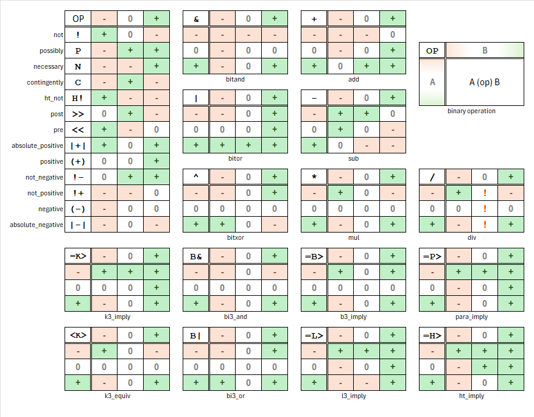

[](https://github.com/h8d13/bt3/actions/workflows/rust.yml)

# BT3 BrainTruck3

**BT3** is a Rust library for manipulating **[balanced ternary](https://en.wikipedia.org/wiki/Balanced_ternary)**.

This system is particularly useful in specialized computing applications such as reversible computing, digital signal processing, and three-valued logic modeling.

This fork extends the original [`balanced-ternary`](https://github.com/Trehinos/balanced-ternary) with additional fixed-width types, unsigned ternary types following TERSCII encoding, and significant performance improvements throughout.

## Features

- **No Standard Library:** Suitable for `#![no_std]` environments.
- **Number Conversions:** Convert between decimal and balanced ternary representations.
- **Arithmetic Operations:** Support for addition, subtraction, multiplication, division, and bit shifting (`<<`, `>>`).
- **[Three-value Logic Operations](https://en.wikipedia.org/wiki/Three-valued_logic):**
    - Support for bitwise and, or, xor, and not (in Kleene algebra (K3)).
    - **Advanced logic**: Implementation of
      [K3](https://en.wikipedia.org/wiki/De_Morgan_algebra#Kleene_algebra),
      [Jones's designs](https://homepage.divms.uiowa.edu/~jones/ternary/),
      [Morton Bit-tricks](https://github.com/Forceflow/libmorton),
      [BI3](https://en.wikipedia.org/wiki/Many-valued_logic#Bochvar's_internal_three-valued_logic),
      [L3](https://en.wikipedia.org/wiki/%C5%81ukasiewicz_logic),
      [RM3](https://en.wikipedia.org/wiki/Paraconsistent_logic#An_ideal_three-valued_paraconsistent_logic),
      [paraconsistent-logic](https://en.wikipedia.org/wiki/Paraconsistent_logic#An_ideal_three-valued_paraconsistent_logic),
      and [HT](https://en.wikipedia.org/wiki/Intermediate_logic) imply operations, more HT, BI3, L3 and post-logic operations.
    - **Consensus** (`a · (a == b)`): extracts positions where both trits agree; zero elsewhere.
    - **Accept-anything** (`sign(a + b)`): the non-zero trit wins; conflicting non-zero trits → `Zero`.
- **Custom Representation:** Parse and display numbers using `+`, `0`, and `-` symbols by default, or custom ones.
- **Multiple storage formats** for different performance/memory trade-offs (see [Storage types](#storage-types)).
- **TERSCII:** Jones's 81-character ternary ASCII encoding for ternary text processing.

## Library features

All features except `ternary-matrix` are enabled by default.

To enable only some features, use the `default-features` option
in your [dependency declaration](https://doc.rust-lang.org/cargo/reference/features.html#dependency-features):

```toml
[dependencies.balanced-ternary]
version = "*.*"
default-features = false
# Choose which ones to enable
features = ["ternary-string", "tryte", "ternary-store", "terscii", "ternary-matrix"]
```

### `ternary-string`

`Ternary` type: a heap-allocated `Vec<Digit>` for arbitrary-precision balanced ternary. Implements `DigitOperate`.

### `tryte`

> Requires `ternary-string`.

Provides `Tryte<N>`: a stack-allocated, `Copy`, fixed-width ternary number of exactly `N` trits. Implements `DigitOperate`.

### `ternary-matrix`

> Requires `ternary-store`.

Provides `TernaryVec` and `TernaryMatrix`: dense ternary linear algebra backed by packed 64-trit BCT words.
Dot product uses 4 AND + 2 OR + 2 POPCNT per 64-trit word, no multiplications.

Also provides `quant`: bit-exact block codecs for ternary weight formats
(`TQ2_0`: 2 bits per trit, `TQ1_0`: 5 trits per byte), and `TernaryMatrix::from_tq2_0` /
`from_tq1_0` to load them. Scales are returned as raw fp16 bits; file parsing (GGUF)
stays with the caller.

`Tq2Matrix` keeps TQ2_0 codes (`t + 1` in 2 bits) for ternary × `i8` products:
`Σ t·x = Σ code·x − Σ x`, with `Σ x` shared by all rows. `block_dots_i8_into` returns one
`i32` per (row, block) so the caller can apply per-block scales. `from_tq1_0` repacks to
TQ2_0 codes once at load, so both formats share the kernels.

### `ternary-store`

> Requires `ternary-string`.

Provides fixed-width storage types optimised for performance and memory:

| Type | Storage | Trits | Range | Notes |
|------|---------|-------|-------|-------|
| `TritsChunk` | `i8` | 5 | −121..121 | 5 balanced trits in one byte; wrapping (mod 3⁵) arithmetic + trit shifts |
| `DataTernary` | `Vec<TritsChunk>` | variable | arbitrary | 5 trits/byte compact storage |
| `Ter40` | `i64` | 40 | ±(3⁴⁰−1)/2 | Fastest arithmetic — native i64 ops |
| `IlTer40` | `u128` | 40 | ±(3⁴⁰−1)/2 | Interleaved BCT; O(1) trit logic on all 40 trits |
| `BctTer32` | `(u32, u32)` | 32 | ±(3³²−1)/2 | Split BCT; O(1) trit-logical ops |
| `BctTer64` | `(u64, u64)` | 64 | ±(3⁶⁴−1)/2 | Split BCT; word type for matrix ops |
| `IlBctTer32` | `u64` | 32 | ±(3³²−1)/2 | Jones interleaved BCT; O(1) logic + arithmetic |
| `UTer9` | `u32` | 9 | 0..19682 | Unsigned BCT, Jones `uter9_t`; O(1) `uter_add` |
| `UTer27` | `u64` | 27 | 0..7625597484986 | Unsigned BCT, Jones `uter27_t`; O(1) `uter_add` |
| `BTer9` | `u32` | 9 | −9841..9841 | Balanced BCT, Jones `bter9_t` |
| `BTer27` | `u64` | 27 | ±(3²⁷−1)/2 | Balanced BCT, Jones `bter27_t` |

## Storage types

Choosing the right type for your use case matters:

- **Arbitrary precision / unknown size** → `Ternary` (heap, O(n) ops)
- **Fixed size, stack-allocated, `Copy`** → `Tryte<N>` (stack, SIMD-vectorizable bitwise)
- **Compact storage of variable data** → `DataTernary` (5 trits/byte)
- **5-trit wrapping ALU** → `TritsChunk` (`i8` math, 3–5× faster than `Tryte<5>`)
- **Fastest arithmetic on ~40-trit values** → `Ter40` (pure i64, no decomposition)
- **O(1) bitwise over all trits at once** → `IlTer40` or `IlBctTer32`
- **O(1) arithmetic + logic combined** → `IlBctTer32` / `UTer9` / `UTer27`
- **Unsigned base-3 counting** → `UTer9` / `UTer27` (BCT addition via Jones BCD trick)
- **Dense ternary linear algebra** → `TernaryVec` / `TernaryMatrix` (`BctTer64` word packing, multiply-free dot)

## Digit Ops



## License

Copyright (c) 2025 [Sébastien GELDREICH](mailto:dev@trehinos.eu)
`Balanced Ternary` is licensed under the [MIT License](LICENSE).
